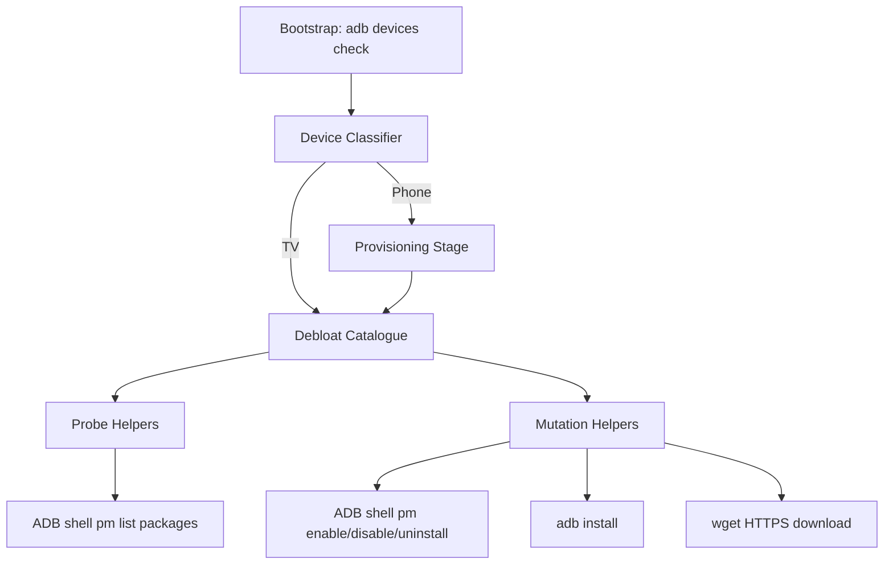

# Architecture

This document complements the root [ARCHITECTURE.md](../ARCHITECTURE.md) with implementation-level detail. It does not duplicate the root document's system context, runtime flow, or design constraints; it elaborates on how the single script's internal structure produces those behaviours.

## Architectural Style

The implemented style is a **procedural command-line batch pipeline** in a single Bash script. Logic is organised into:

1. A bootstrap guard (device detection)
2. A small set of helper functions for package-state probes and mutations
3. A declarative-looking sequence of package groups that drive those helpers

This style keeps the system easy to run and easy to extend by appending package identifiers, but it centralises orchestration, couples behaviour tightly to ADB command semantics, and leaves failure handling largely to the invoked command-line tools.

## Internal Component Decomposition

```
android-debloater.sh
│
├── Bootstrap
│   └── ADB_DEVICES=$(adb devices | grep -w "device" | grep -v "List")
│   └── [ -z "${ADB_DEVICES}" ] → exit 1
│
├── Probe Helpers (read-only)
│   ├── is_android_package_installed
│   └── is_android_package_disabled
│
├── Mutation Helpers (write)
│   ├── enable_android_package
│   ├── disable_android_package
│   ├── install_android_package
│   ├── uninstall_android_package
│   └── reinstall_android_package
│
├── Classifier
│   └── is_android_package_installed 'com.google.android.tv.remote.service'
│       → DEVICE_TYPE='TV' | 'Phone'
│
├── Provisioning Stage (Phone only)
│   └── install_android_package × N (Aurora, F-Droid, Fossify, Breezy)
│       └── SIM heuristic: is_android_package_installed 'com.android.stk'
│
└── Debloat Catalogue Executor
    └── disable_android_package / uninstall_android_package × ~300 entries
```

## Component Interaction Model



## Data Flow Through Components

1. **Bootstrap** reads `adb devices` stdout once; stores in `ADB_DEVICES` variable
2. **Classifier** calls `is_android_package_installed`, which shells out to `adb shell pm list packages --user 0`, pipes through `sed` and `grep`
3. **Provisioning** calls `install_android_package`, which:
   - Probes installed state (same as classifier)
   - Downloads APK via `wget --continue` to `${PACKAGE_NAME}.apk` in CWD
   - Installs via `adb install --user 0`
   - Removes temporary APK via `rm`
4. **Catalogue executor** calls `disable_android_package` or `uninstall_android_package`, each of which:
   - Probes disabled/installed state
   - Skips if predicate already satisfied
   - Otherwise invokes `adb shell pm disable-user --user 0` or `adb shell pm uninstall --user 0`

## State Management

The script maintains **no persistent host-side state**. All state is either:

- **Transient in-memory** — `ADB_DEVICES`, `DEVICE_TYPE`, loop variables
- **Device-side persistent** — Android package manager state for user 0 (enabled/disabled/installed)
- **Temporary host files** — `${PACKAGE_NAME}.apk` during provisioning (deleted after install attempt)

## Failure Propagation

```
Bootstrap failure → exit 1 (only explicit guard)
Probe failure → grep returns non-zero → function returns 1 → caller skips or proceeds
Mutation failure → adb prints error to stderr → script continues to next package
Download failure → wget prints error → adb install fails → rm still executes
```

There is no error aggregation, no retry, no rollback, and no final summary.

## Boundary Contracts

| Boundary | Contract | Owner |
|----------|----------|-------|
| Host ↔ ADB | `adb devices`, `adb shell pm ...`, `adb install` | Android Platform Tools |
| Host ↔ Network | HTTPS GET via `wget --continue` | Upstream APK providers |
| Script ↔ Device | Package identifiers must match `pm list packages` output | Android OEM/ROM |
| Script ↔ CI | ShellCheck error-severity diagnostics must be zero | GitHub Actions |

## Extension Points

1. **Add package to catalogue** — Append identifier to appropriate `disable_android_package` or `uninstall_android_package` call
2. **Add provisioning APK** — Add `install_android_package 'name' 'url'` line in provisioning section
3. **Change classification heuristic** — Modify the `com.google.android.tv.remote.service` check
4. **Add device targeting** — Would require threading `-s ${SERIAL}` through all ADB calls (not currently implemented)

## Anti-Patterns Present

- **No `set -euo pipefail`** — Script does not enable strict mode; failures are silently absorbed
- **No device serial threading** — Multiple connected devices create ambiguity
- **Hard-coded URLs** — Provisioning URLs embedded in source; no externalisation
- **No checksum verification** — Downloaded APKs not verified before install
- **No dry-run mode** — Script executes immediately without confirmation
- **No summary report** — No final reconciliation of what was changed