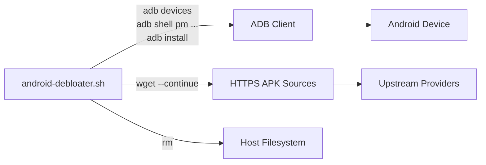

# Integration Models Component

This document describes the external integration boundaries and data contracts for Android Debloater.

## Integration Boundaries



## ADB Integration

### Contract

| Operation | Command | Input | Output |
|-----------|---------|-------|--------|
| Device enumeration | `adb devices` | None | Text table: serial, status |
| Package list (all) | `adb shell pm list packages --user 0` | None | `package:<name>` lines |
| Package list (disabled) | `adb shell pm list packages --user 0 -d` | None | `package:<name>` lines |
| Enable package | `adb shell pm enable --user 0 <name>` | Package name | Success/failure message |
| Disable package | `adb shell pm disable-user --user 0 <name>` | Package name | Success/failure message |
| Uninstall package | `adb shell pm uninstall --user 0 <name>` | Package name | Success/failure message |
| Reinstall system | `adb shell pm install-existing --user 0 <name>` | Package name | Success/failure message |
| Install APK | `adb install --user 0 <file>` | APK file path | Success/failure message |

### Assumptions

- ADB daemon running and authorised on target device
- Single target device or unambiguous ADB context (no `-s` flag used)
- Package names match exactly what `pm list packages` returns
- User 0 is the target user for all operations

### Failure Modes

- Device unauthorised → `adb devices` shows "unauthorized" → script sees no devices → exits
- Package not found → `pm` commands print error → script continues
- ADB connection lost mid-run → subsequent commands fail → script continues

## HTTPS APK Download Integration

### Contract

| Operation | Command | Input | Output |
|-----------|---------|-------|--------|
| Download APK | `wget --continue <url> -O <file>` | URL, output path | APK file or error |

### Providers and URLs (Hard-coded)

| Package | URL | Provider |
|---------|-----|----------|
| `com.aurora.store` | `https://auroraoss.com/downloads/AuroraStore/Release/AuroraStore-4.6.2.apk` | Aurora Store |
| `org.fdroid.fdroid` | `https://f-droid.org/F-Droid.apk` | F-Droid |
| `org.fossify.calculator` | `https://f-droid.org/repo/org.fossify.calculator_3.apk` | Fossify |
| `org.fossify.calendar` | `https://f-droid.org/repo/org.fossify.calendar_4.apk` | Fossify |
| `org.fossify.camera` | `https://f-droid.org/repo/org.fossify.camera_2.apk` | Fossify |
| `org.fossify.clock` | `https://f-droid.org/repo/org.fossify.clock_1.apk` | Fossify |
| `org.fossify.filemanager` | `https://f-droid.org/repo/org.fossify.filemanager_2.apk` | Fossify |
| `org.fossify.gallery` | `https://f-droid.org/repo/org.fossify.gallery_9.apk` | Fossify |
| `org.fossify.home` | `https://f-droid.org/repo/org.fossify.home_16.apk` | Fossify |
| `org.fossify.keyboard` | `https://f-droid.org/repo/org.fossify.keyboard_3.apk` | Fossify |
| `org.breezyweather` | `https://f-droid.org/repo/org.breezyweather_50208.apk` | Breezy Weather |
| `org.fossify.contacts` | `https://f-droid.org/repo/org.fossify.contacts_2.apk` | Fossify |
| `org.fossify.phone` | `https://f-droid.org/repo/org.fossify.phone_3.apk` | Fossify |
| `org.fossify.messages` | `https://f-droid.org/repo/org.fossify.messages_2.apk` | Fossify |

### Assumptions

- HTTPS endpoints remain stable and serve correct APKs
- No authentication required
- `wget --continue` handles partial downloads
- Android verifies APK signature on install

### Failure Modes

- Network unavailable → `wget` fails → `adb install` fails → temp file removed
- URL changed/404 → `wget` fails → same as above
- APK corrupted → `adb install` fails → temp file removed
- No checksum verification implemented

## Host Filesystem Integration

### Contract

| Operation | Command | Path | Lifetime |
|-----------|---------|------|----------|
| Write APK | `wget -O` | `${PWD}/${PACKAGE_NAME}.apk` | Until `rm` |
| Remove APK | `rm` | `${PWD}/${PACKAGE_NAME}.apk` | Immediate |

### Assumptions

- Current working directory is writable
- No concurrent script instances using same CWD
- Sufficient disk space for APKs (~10-50 MB each)

## GitHub Actions Integration

### Contract

| Trigger | Event | Job | Tool |
|---------|-------|-----|------|
| Push/PR to master | `push`, `pull_request` | `check` | ShellCheck |
| Manual | `workflow_dispatch` | `check` | ShellCheck |

### Configuration

```yaml
permissions:
  contents: read
jobs:
  check:
    runs-on: ubuntu-latest
    steps:
      - uses: actions/checkout@v7
      - run: |
          shopt -s globstar nullglob
          shellcheck **/*.sh --severity error
```

## Data Contracts Summary

| Data | Producer | Consumer | Format | Validation |
|------|----------|----------|--------|------------|
| Device list | ADB | Script | Text table | `grep -w "device"` |
| Package list | Android PM | Script | `package:<name>` lines | `sed` + `grep` |
| APK binary | HTTPS | Script → ADB | Binary | Android install verifies |
| ShellCheck diagnostics | ShellCheck | CI | Text | Exit code ≠ 0 fails job |