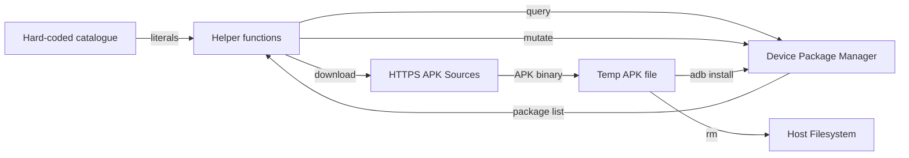

# Data Model

Android Debloater has **no persistent host-side data model**. The script operates on transient in-memory data and device-side persistent state owned by the Android package manager.

## Data Categories

### 1. Transient Host-Side Data (In-Memory)

| Variable | Type | Scope | Lifetime | Source |
|----------|------|-------|----------|--------|
| `ADB_DEVICES` | String | Global | Script invocation | `adb devices` output |
| `DEVICE_TYPE` | String (`Phone`\|`TV`) | Global | Script invocation | Package heuristic |
| `PACKAGE_NAME` | String | Function parameter | Function call | Catalogue literal |
| `PACKAGE_URL` | String | Function parameter | Function call | Catalogue literal |
| `PACKAGE_FILE` | String | Function local | Function call | Derived from name |

### 2. Device-Side Persistent State (Android Package Manager)

| Entity | Owner | Representation | Mutations |
|--------|-------|----------------|-----------|
| Package installed state | Android PM | `pm list packages --user 0` | `pm uninstall`, `pm install-existing`, `adb install` |
| Package enabled state | Android PM | `pm list packages --user 0 -d` | `pm disable-user`, `pm enable` |
| Package data | Android PM | Internal (per-package) | Preserved on disable; may be removed on uninstall |

### 3. Temporary Host Files

| File | Location | Lifetime | Content |
|------|----------|----------|---------|
| `${PACKAGE_NAME}.apk` | `${PWD}/` | `wget` → `adb install` → `rm` | APK binary |

## Data Flow Diagram



## Package Identifier Format

All package identifiers follow Android package naming convention:
- Reverse domain notation: `com.vendor.appname`
- Lowercase alphanumeric with dots
- Examples: `com.google.android.youtube`, `com.samsung.android.dialer`

## State Transitions (Device-Side)

```
INSTALLED + ENABLED  --disable_android_package-->  INSTALLED + DISABLED
INSTALLED + DISABLED --enable_android_package-->   INSTALLED + ENABLED
INSTALLED + ENABLED  --uninstall_android_package--> NOT_INSTALLED
NOT_INSTALLED        --install_android_package-->  INSTALLED + ENABLED
NOT_INSTALLED        --reinstall_android_package--> INSTALLED + ENABLED (if in system image)
```

## Invariants

1. **User 0 scope** — All state queries and mutations target `--user 0` exclusively
2. **No host persistence** — Script creates no databases, config files, or logs
3. **Catalogue as source of truth** — Package identifiers only exist as string literals in script
4. **Device owns truth** — Actual package state authoritative; script probes before mutating

## Data Validation

- **Input validation**: None (package names trusted as hard-coded literals)
- **Output validation**: None (ADB output parsed via `grep`/`sed`; no schema validation)
- **APK validation**: None (no checksum; Android verifies on install)

## Schema Evolution

Since there is no external schema, evolution occurs only through script modifications:
- Adding package identifiers → extends catalogue
- Removing package identifiers → shrinks catalogue
- Changing URLs → updates provisioning sources
- Changing heuristic → alters device classification