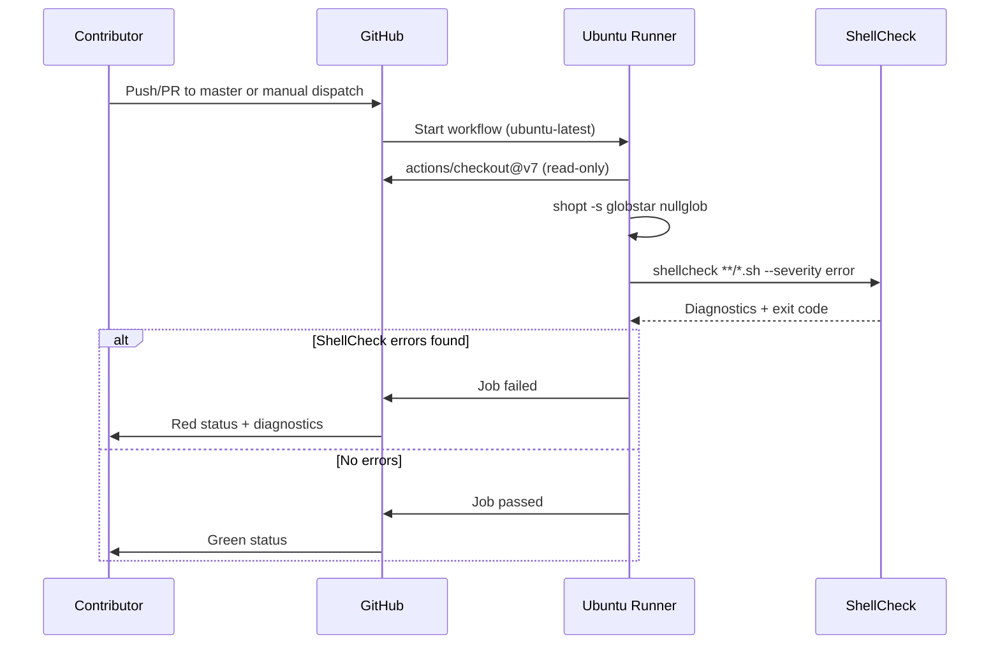

# Continuous Integration Flow

This flow covers the GitHub Actions ShellCheck validation workflow.

## Sequence



## Workflow Configuration

```yaml
name: Bash
on:
  push:
    branches: [master]
  pull_request:
    branches: [master]
  workflow_dispatch:
permissions:
  contents: read
jobs:
  check:
    name: ShellCheck
    runs-on: ubuntu-latest
    steps:
      - uses: actions/checkout@v7
      - run: |
          shopt -s globstar nullglob
          shellcheck **/*.sh --severity error
```

## Triggers

| Trigger | Branches | Manual |
|---------|----------|--------|
| Push | master | No |
| Pull Request | master | No |
| Manual dispatch | Any | Yes |

## Validation Scope

- All `**/*.sh` files in repository (currently only `android-debloater.sh`)
- ShellCheck severity: `error` only (warnings ignored)
- ShellCheck version: Ubuntu latest default

## Failure Modes

- ShellCheck error diagnostic → job fails → PR blocked (if branch protection enabled)
- `actions/checkout` failure → job fails
- Runner unavailable → job queued/failed

## Artefacts

- No artefacts produced
- Diagnostics visible in workflow log only