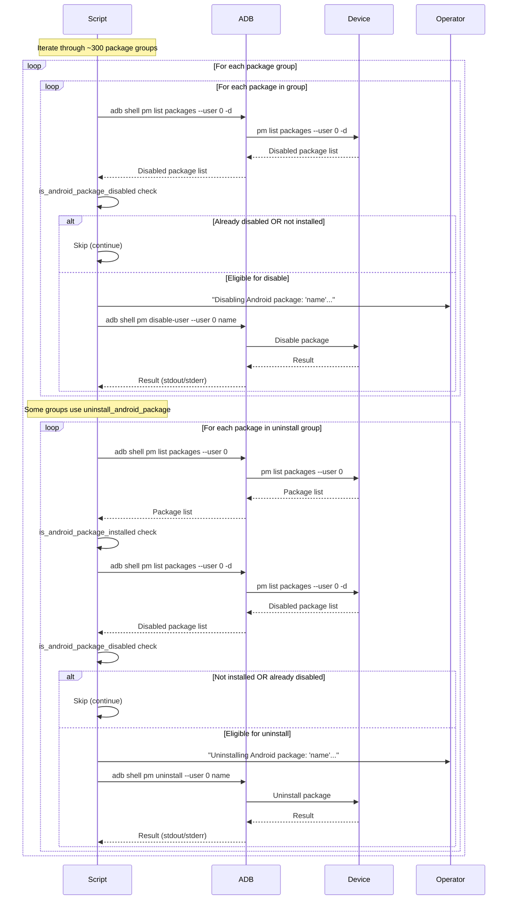

# Package Deactivation Flow

This flow covers the main debloat catalogue execution that runs for both phones and TVs after provisioning (if applicable).

## Sequence

## Package Groups (Representative)

| Category | Operation | Package Count (Approx) |
|----------|-----------|------------------------|
| Accessibility | disable | 15 |
| App Management | disable | 2 |
| App Store | disable | 2 |
| AR & VR | disable | 7 |
| Audio | disable | 1 |
| Backup & Sync | disable | 15 |
| Browser | disable | 3 |
| Calculator | disable | 4 |
| Calendar | disable | 3 |
| Camera | disable | 9 |
| Chat | disable | 2 |
| Cleaner | disable | 1 |
| Clock | disable | 5 |
| Cloud Storage | disable | 3 |
| Compass | disable | 2 |
| Contacts | disable | 8 |
| Debug | disable | 3 |
| Dialer | disable | 2 |
| Dictionary | disable | 1 |
| Email | disable | 5 |
| File Manager | disable | 7 |
| Font | disable | 1 |
| Gallery | disable + uninstall | 6 + 1 |
| Game Tools | disable | 7 |
| Image Editor | disable | 1 |
| IoT | disable | 5 |
| Keyboard | disable | 3 |
| Location | disable | 1 |
| Manual & Help | disable | 4 |
| Maps | disable | 1 |
| Music Players | disable | 6 |
| News | disable | 1 |
| Notes | disable | 3 |
| Office Suites | disable | 1 |
| Parental Control | disable + uninstall | 3 + 1 |
| Personalisation | uninstall | 2 |
| Radio | disable | 4 |
| Screen Recorder | disable | 4 |
| Search | disable | 1 |
| Security | disable | 3 |
| Sharing | disable | 10 |
| Sidebar | disable | 1 |
| SMS | disable | 4 |
| Sound Recorders | disable | 4 |
| Task Manager | disable | 1 |
| Tasks & Reminders | disable | 2 |
| Terminal | disable | 1 |
| Theme | disable + uninstall | 4 + 1 |
| Vendor Account | disable | 2 |
| Vendor Social | disable | 1 |
| Video Editor | disable | 4 |
| Video Player | disable | 7 |
| Voice Assistant | disable | 8 |
| Wallet | disable | 2 |
| Warranty | disable | 1 |
| Wearable | disable | 1 |
| Weather | disable | 4 |
| WebView | disable | 1 |
| System Analytics/Telemetry | disable | 15 |
| System Factory Test | disable | 8 |
| System Setup Wizard | disable | 4 |
| System UI Navigation | disable | 1 |
| System Update | disable | 1 |
| Others | disable | 30 |
| Degoogle | disable | 10 |
| Demetafy | disable | 3 |

**Total: ~300 package identifiers**

## Decision Points

| Decision | Condition | True Branch | False Branch |
|----------|-----------|-------------|--------------|
| Package disabled/absent | `is_android_package_disabled` | Skip | Disable |
| Package installed & enabled | `is_android_package_installed` && !disabled | Uninstall (for uninstall groups) | Skip |

## Data Transformations

- Package identifier (string literal) → ADB command argument
- ADB output → console (passthrough)

## Side Effects

- Device package state mutated (disabled or uninstalled for user 0)
- Console output for each operation

## Error Paths

- `pm disable-user` fails (package protected, not found) → error printed → continue
- `pm uninstall` fails (system package, not found) → error printed → continue
- ADB connection lost → subsequent commands fail → continue

## Idempotence

- Re-running script: already-disabled packages skipped (probe returns true)
- Already-uninstalled packages skipped (probe returns false for installed)
- No rollback or compensation for partial failures