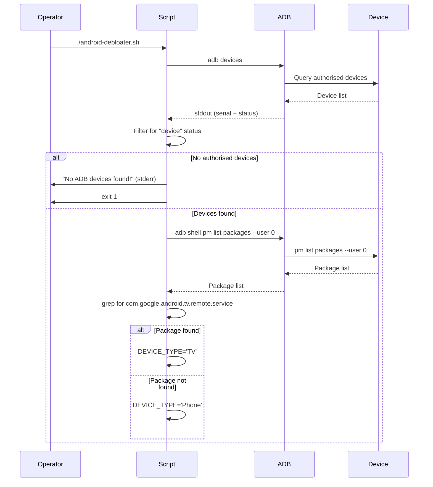

# Startup and Rendering Flow

This flow covers the initial bootstrap, device detection, classification, and the transition into the main debloat execution.

## Sequence

## Decision Points

| Decision | Condition | True Branch | False Branch |
|----------|-----------|-------------|--------------|
| Device present | `ADB_DEVICES` non-empty | Continue | Exit 1 |
| Device type | `com.google.android.tv.remote.service` installed | TV | Phone |

## Data Transformations

1. `adb devices` raw output → filtered to authorised device serials
2. `pm list packages` output → `sed` sanitisation → `grep` exact match

## Side Effects

- None (read-only operations)

## Error Paths

- `adb` not in PATH → command not found → script fails
- ADB daemon not running → `adb devices` fails → no devices → exit 1
- Device unauthorised → not in "device" list → exit 1